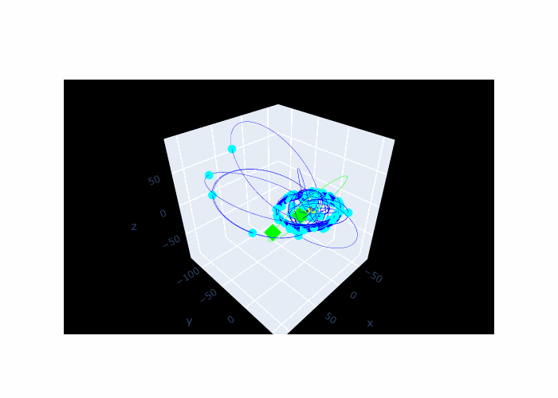
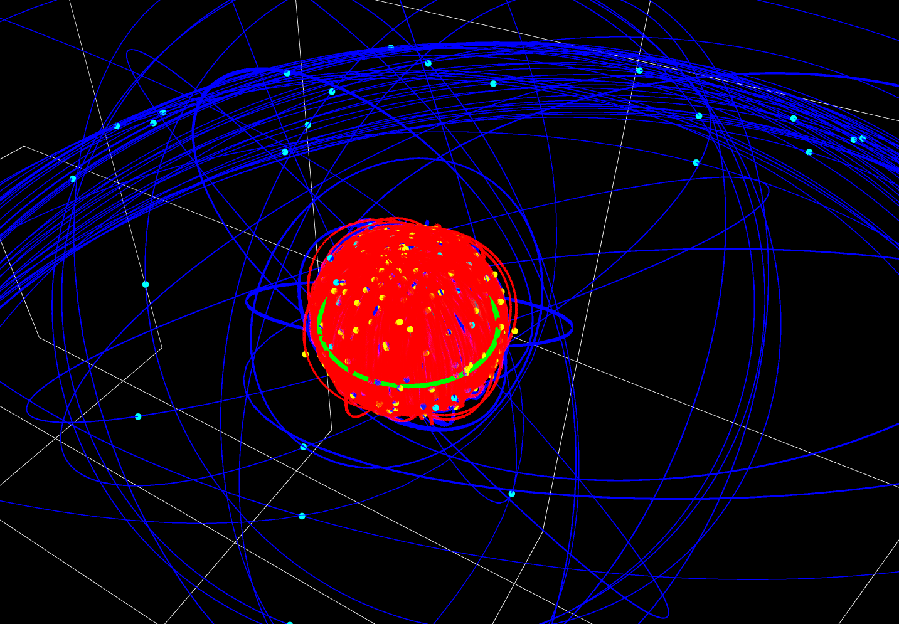
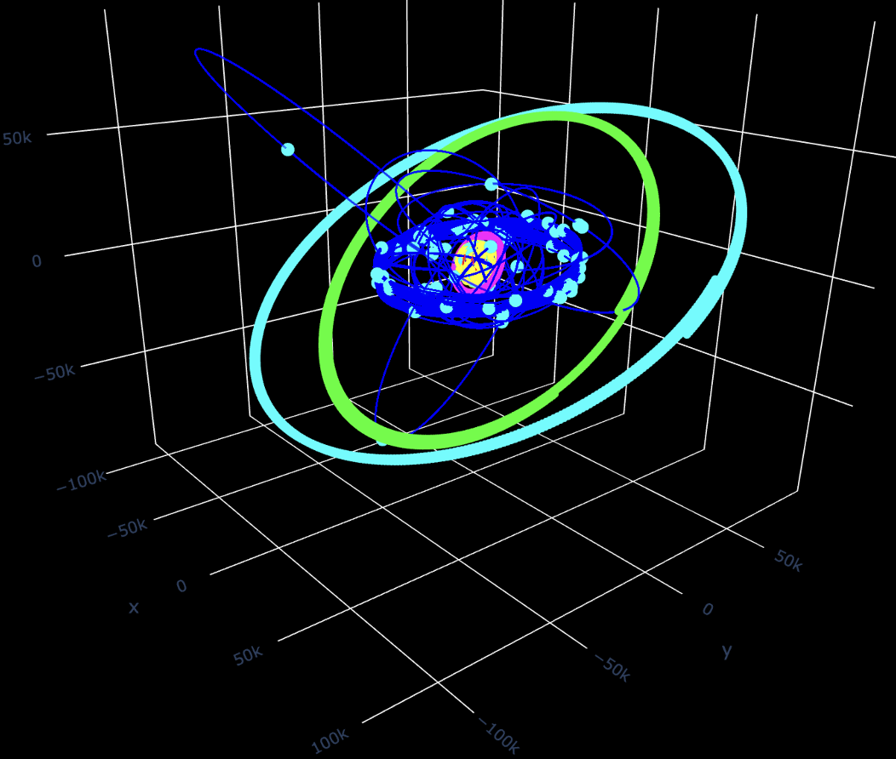
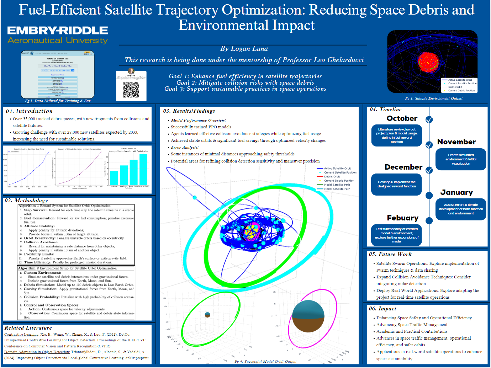
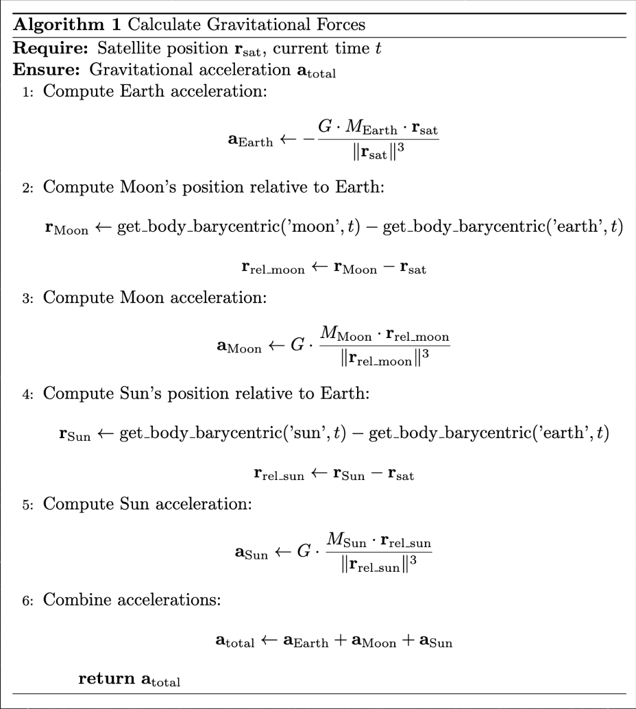
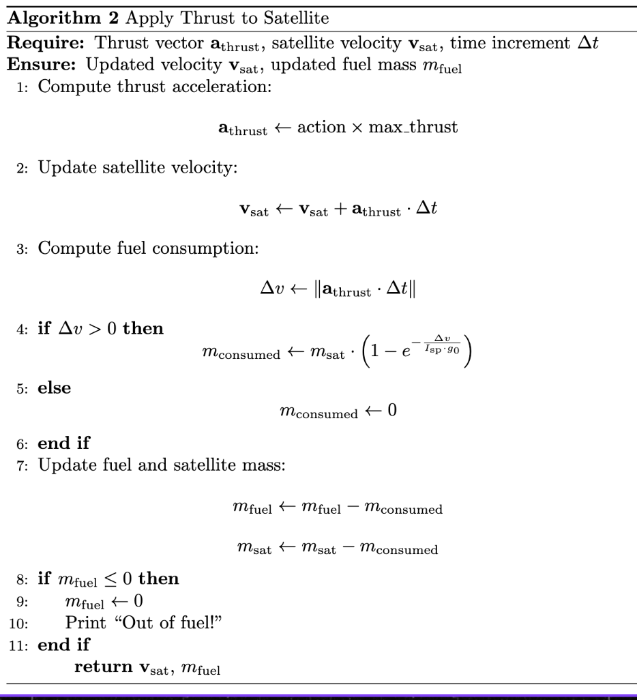
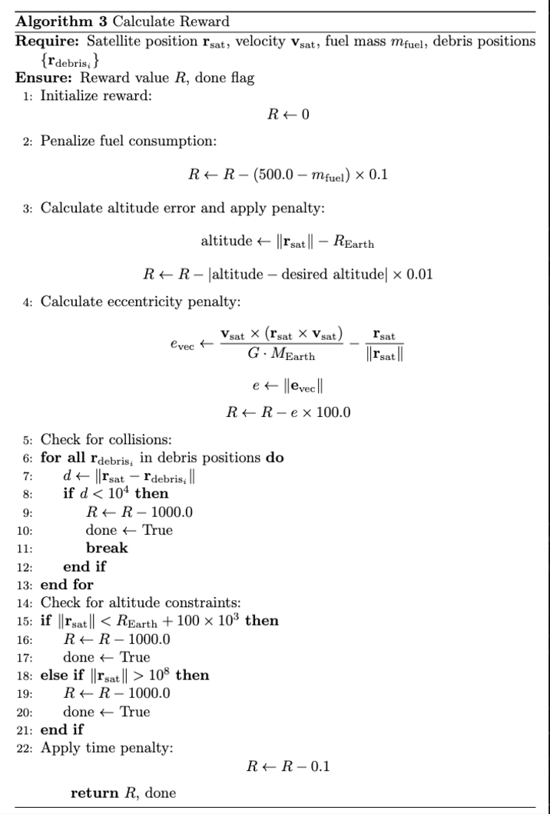
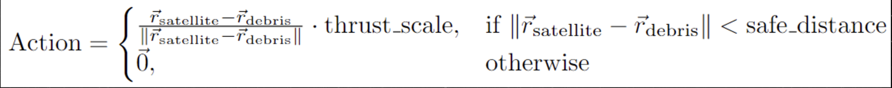

# Satellite Trajectory Projection and Collision Avoidance

[](LICENSE)
[](https://www.python.org/downloads/release/python-380/)

## Table of Contents
- [Overview](#overview)
- [Features](#features)
- [Environment Setup](#environment-setup)
- [Installation](#installation)
- [Usage](#usage)
- [Data](#data)
- [Performance Metrics](#performance-metrics)
- [Environment Design & Setup](#environment-design--setup)
- [Reward Function Design](#reward-function-design)
- [Current Results](#current-results)
- [Credits](#credits)

## Overview

This project implements an AI-powered satellite trajectory projection and collision avoidance system using reinforcement learning. It combines real-world satellite tracking data (TLE - Two-Line Element sets) with a Proximal Policy Optimization (PPO) model to predict and avoid potential collisions with space debris and other satellites.

### Video Demonstration of Training
| _Blue_: Active Satellites in orbit | _Red_: Debris in orbit | _Green_: Predicted trajectory for model|



*This animation demonstrates satellite trajectory adjustments with real-time collision avoidance.*

## Performance Metrics and Key Results

Evaluation summary (1,000 scenarios; deterministic seeds):

| Policy           | Success Rate | Collision Rate |
|------------------|--------------|----------------|
| PPO (learned)    | ~97.5%       | ~2.5%          |
| Impulsive ΔV     | ~27.5%       | ~72.5%         |
| Rule-based       | ~20.7%       | ~79.3%         |
| No action        | 0%           | 100%           |

Notes:
- “Success” = survived to episode horizon without collision (some runs may end via fuel depletion).
- Artifacts include per-episode aggregates, time series, termination counts, and plots under `results/evaluation/<timestamp>/`.

## Features

- **Real-time TLE Data Fetching**: Retrieves up-to-date satellite and debris data from CelesTrak.
- **3D Visualization**: Provides an interactive 3D environment to visualize satellite orbits and debris.
- **AI-powered Collision Avoidance**: Utilizes a PPO model to dynamically avoid collisions.
- **Dynamic Orbit Scaling**: Adjusts orbit scales for improved visualization.
- **Gravitational Influence Modeling**: Accounts for Earth's and Moon's gravitational effects on satellite orbits.
- **Performance Metrics Tracking**: Logs and analyzes performance metrics during simulations.
- **Deterministic Evaluator & Plots**: Generates per-episode/per-policy CSVs and plots (collision rates, Δv usage, min distance, termination reasons).
- **Per-Component Rewards**: Exports survival, distance, closing, Δv penalties, smoothness, milestones, and collision penalties per episode.
- **Multiple Baselines**: Compare PPO against rule-based, impulsive ΔV, and no-action baselines.

<div style="display: flex; justify-content: center; align-items: center;">
  
  
</div>




## Prerequisites

- **Python 3.8+**
- **pip** package manager

## Installation

1. **Clone the Repository**
   ```bash
   git clone https://github.com/Logan-Cole-Luna/sat-trajectory-avoidance
   cd sat-trajectory-avoidance
   ```

2. **Create Virtual Environment**
   ```bash
   python -m venv venv
   source venv/bin/activate  # On Windows: venv\Scripts\activate
   ```

3. **Install Dependencies**
   ```bash
   ./setup.sh 
   ```

## Usage

### Download TLE Data from CelesTrack
```bash
python tle_export.py
```

### Implement and Run the pretrained Satellite Model

```bash
python implement_sat.py
```

### Train Your Own Satellite Model

```bash
python train_sat.py
```

### Ealuate Satellite Model

```bash
python evaluate_sat.py --model models/satellite_avoidance_model.zip --episodes 1000
```

Outputs are written to `results/evaluation/<timestamp>/` (ignored by git). You’ll get:
- `policy_aggregates.csv`, `termination_reasons.csv`, `all_policies_per_episode.csv`
- Optional time series and plots under `plots/`
- Reward component means and per-episode component CSVs

## Data
The project uses TLE data from CelesTrak, stored in the tle_data/ directory. Ensure the TLE files are up-to-date for accurate simulations.

## Performance Metrics
Performance metrics such as collision counts, reward accumulation, delta-v usage, and minimum distances to debris are logged and can be reviewed to evaluate the model's effectiveness.

## Environment Design & Setup:
<div style="display: flex; justify-content: center; align-items: center;">
  
  
</div>


## Reward Function Design


## Current Results

### Baselines Compared

- PPO (learned policy)
- Rule-based risk-aware controller (lateral push-away when within unsafe distance)
- Impulsive ΔV (finite-duration lateral thrust to approximate an instantaneous Δv pre-TCA)
- No action (do nothing)

Brief note on impulsive baseline: In classical astrodynamics, an “impulsive” burn models an instantaneous Δv with no position change; we approximate this with sustained lateral acceleration over several steps due to thrust limits.

### Baseline Function For Evaluation:


- **Velocity Adjustment**: Adjusts velocity away from the nearest debris object if it is within a defined unsafe distance.
- **No Action**: Maintains current trajectory if no debris is within the unsafe distance.

### Model Performance Overview
- PPO achieves ~97.5% collision-free episodes on 1,000 scenarios; rule-based ~20.7%; impulsive ΔV ~27.5%; no-action 0%.
- PPO yields larger average separation at closest approach and uses more Δv than heuristics (trading fuel for safety).
- Termination breakdowns and reward component tables are exported per evaluation run.

### Error Analysis
- **Delta-v Efficiency**: While prioritizing collision avoidance, the PPO models consumed more delta-v than the baseline.
- **Collision Detection Sensitivity**: Needs refinement for better accuracy.
- **Reward Function**: Currently unbalanced and requires adjustments.
- **Documentation**: Additional documentation on fuel metrics is necessary.

## Credits
- **Data Sources**: Credit to [Celestrak](https://celestrak.com/) for providing TLE data.
